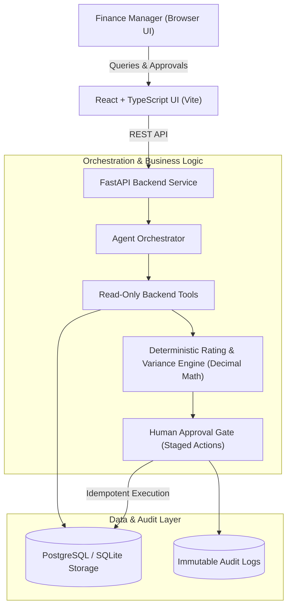

# FinPilot — AI Finance Operations Agent

> **An evidence-backed, deterministic AI agent for modern B2B finance teams to investigate invoice discrepancies, analyze overdue receivables, and execute human-approved adjustments.**

[](https://fastapi.tiangolo.com)
[](https://react.dev)
[-3776AB.svg?style=flat&logo=python)](https://python.org)
[](https://pytest.org)

---

## 1. What Problem FinPilot Solves

Finance teams managing hundreds of complex usage-based invoices face high-stakes operational friction:
* *Why did Acme Corp’s bill jump by ₹12,000 this billing cycle?*
* *Is a spike caused by legitimate customer usage volume, or an unauthorized rate calculation error?*
* *Which accounts are past due, and what is their exact aged outstanding balance?*
* *Are invoice line items violating contract pricing rules or missing free-tier allowances?*

Standard conversational chatbots cannot be trusted with these questions because **generative LLMs hallucinate numbers and approximate floating-point math**. 

**FinPilot is an autonomous operations agent, not a generic chatbot**:
1. **Zero Hallucinations**: All arithmetic is computed in deterministic Python using `Decimal` arithmetic—the LLM is strictly used for natural language translation and synthesis.
2. **Evidence-Backed**: Every explanation links to primary database records displayed in side-by-side evidence cards.
3. **Safe Tool Execution (Least Privilege)**: Read-only tools inspect data freely, while mutating financial adjustments are staged as **proposals** requiring human authorization.
4. **Strict Idempotency**: Double-clicks or duplicate approval requests never apply duplicate credits or ledger changes.
5. **Immutable Audit Trail**: All agent tool invocations, prompts, proposals, approvals, and mutations are permanently logged.

---

## 2. System Architecture



---

## 3. Database Schema

The database models are implemented using SQLAlchemy ORM with precise `Numeric(18, 4)` and `Decimal` fields:

| Table | Purpose |
| :--- | :--- |
| `customers` | Customer profiles, plan tiers (Starter, Pro, Enterprise), payment terms |
| `invoices` | Billing periods, statuses (`ISSUED`, `PAID`, `OVERDUE`, `DISPUTED`, `ADJUSTED`), subtotals, tax |
| `invoice_line_items` | Itemized charges, quantities, unit prices, line types (`BASE_FEE`, `USAGE_TIER`, `ADJUSTMENT`) |
| `pricing_rules` | Contract-level pricing schedules, tiered overage thresholds, free allowances |
| `usage_events` | Metered usage records and consumption timestamps |
| `payments` | Transaction amounts, settlement dates, reference IDs |
| `agent_sessions` | Conversation context and investigation sessions |
| `agent_runs` | Run status, query intent, tool execution timings, structured explanations |
| `tool_calls` | Exact tool inputs, outputs, execution duration, and error codes |
| `action_proposals` | Staged financial actions (`INVOICE_ADJUSTMENT`, `PAYMENT_REMINDER`) awaiting human approval |
| `approvals` | Reviewer names, decisions (`APPROVED`, `REJECTED`), comments, timestamps |
| `audit_logs` | Cryptographic audit trail with before/after state diffs and performer signatures |

---

## 4. Benchmark Scenario: Acme Corp ₹12,000 Spike

### The Scenario
A finance manager asks:  
> *"Why is Acme Corp's invoice ₹12,000 higher this month?"*

### FinPilot's 7-Step Investigation Workflow:
1. **Intent Extraction**: Identifies customer `Acme Corp` and the periods `2026-09` vs `2026-10`.
2. **Tool Invocation**:
   - `search_invoices(customer_query="Acme Corp")`
   - `compare_customer_invoices(customer_query="Acme Corp")`
   - `get_customer_usage(customer_query="Acme Corp", metric_name="api_calls")`
   - `audit_invoice_pricing_compliance(invoice_number_or_id="INV-2026-OCT-0102")`
3. **Deterministic Variance Decomposition**:
   $$\Delta\text{Total} = \text{Volume Variance} + \text{Rate Variance}$$
   - **Base (Sep 2026)**: ₹118,000.00
   - **Target (Oct 2026)**: ₹130,000.00
   - **Net Increase**: **+₹12,000.00 (+10.17%)**
   - **Volume Variance**: +50,000 API calls consumed $\times$ contracted ₹0.18 = **+₹9,000.00**
   - **Rate Discrepancy Error**: 150,000 calls billed @ ₹0.20 instead of agreed ₹0.18 = **+₹3,000.00 overcharge**
4. **Evidence Synthesis**: Surfaces primary database cards in the Evidence Drawer with the mathematical proof.
5. **Proposal Generation**: Stages a **Credit Memo Proposal of ₹3,000.00** for human approval.
6. **Human Approval**: The reviewer clicks *Approve & Apply Adjustment*.
7. **Idempotent Ledger Execution**: The invoice is updated to ₹127,000.00 (`ADJUSTED`), an audited adjustment line item is added, and the audit log records the state change. Any repeat approval attempt is rejected with an idempotency guard.

---

## 5. Quick Start & Setup

### Prerequisites
* Python 3.9+ (or 3.11+)
* Node.js v18+ and npm
* (Optional) Docker & Docker Compose

### 1. Backend Setup
```bash
# Navigate to project root
cd "Project 3- FinPilot — AI Finance Operations Agent"

# Activate virtual environment
source .venv/bin/activate

# Install dependencies (already pinned in requirements.txt)
pip install -r backend/requirements.txt

# Run the automated test suite (10/10 passing tests)
PYTHONPATH=. pytest backend/tests/ -v

# Start the FastAPI backend server
PYTHONPATH=. uvicorn backend.app.main:app --host 127.0.0.1 --port 8000 --reload
```
* The API will be live at `http://127.0.0.1:8000`
* Interactive OpenAPI Swagger documentation: `http://127.0.0.1:8000/docs`

### 2. Frontend Setup
```bash
# In another terminal window:
cd frontend

# Install dependencies
npm install

# Start Vite dev server (proxies /api to 127.0.0.1:8000)
npm run dev
```
* Open your browser at: `http://localhost:5173/`

### 3. Docker Compose Deployment
```bash
docker-compose up --build
```

---

## 6. Automated Test Suite

FinPilot comes with a comprehensive test suite covering all critical engineering requirements:

```
backend/tests/test_api_scenarios.py::test_health_check PASSED
backend/tests/test_api_scenarios.py::test_agent_query_acme_corp_invoice_spike PASSED
backend/tests/test_api_scenarios.py::test_agent_query_overdue_invoices PASSED
backend/tests/test_api_scenarios.py::test_human_approval_api_workflow PASSED
backend/tests/test_approval_idempotency.py::test_proposal_creation_does_not_mutate_invoice PASSED
backend/tests/test_approval_idempotency.py::test_rejection_leaves_invoice_untouched PASSED
backend/tests/test_approval_idempotency.py::test_approval_executes_adjustment_and_preserves_idempotency PASSED
backend/tests/test_deterministic_calculations.py::test_acme_corp_deterministic_invoice_comparison PASSED
backend/tests/test_deterministic_calculations.py::test_audit_pricing_compliance_rate_mismatch PASSED
backend/tests/test_deterministic_calculations.py::test_calculate_aging_and_outstanding PASSED

============================== 10 passed in 0.97s ==============================
```

---

## 7. Key Talking Points for Zenskar Interviews

1. **Deterministic vs Generative Boundaries**:
   Explain how FinPilot delegates tool execution, filtering, and mathematical variance calculations to pure Python (`Decimal`), restricting the LLM to query understanding and contextual explanation.
2. **Human-in-the-Loop Financial Safety**:
   Discuss why an AI agent must never unilaterally mutate account ledgers or dispatch credit notes, and how FinPilot implements atomic, auditable action proposals.
3. **Idempotency in Billing Operations**:
   Explain how proposals track execution state (`PENDING` $\to$ `EXECUTED`), ensuring duplicate clicks or retries do not trigger duplicate ledger adjustments.
4. **Primary Source Traceability**:
   Highlight how the Evidence Drawer provides forensic evidence for every claim, satisfying enterprise CFO compliance and audit standards.
